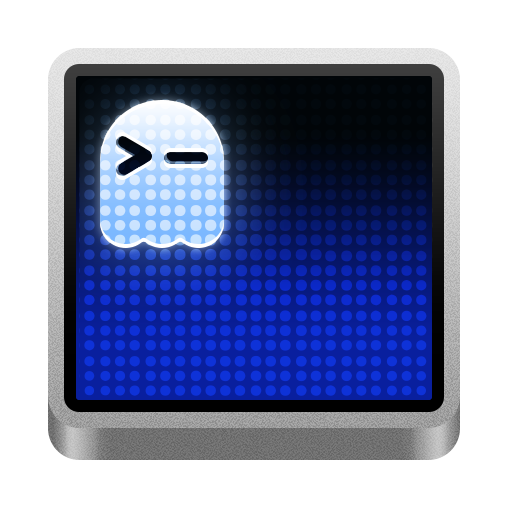

<!-- LOGO -->
<h1 align="center">
  
   Snow Ghostty
</h1>

  A native, GPU-accelerated terminal for Mac OS X Snow Leopard.
   
  Powered by <code>libghostty-vt</code>.
   
  <a href="#about">About</a>
  ·
  <a href="https://github.com/EriksRemess/snow-ghostty/releases/latest">Download</a>
  ·
  <a href="USAGE.md">Documentation</a>
  ·
  <a href="HACKING.md">Developing</a>

## About

Snow Ghostty brings Ghostty's terminal engine to older Intel Macs with a native
Cocoa interface, CoreText fonts, and an OpenGL 2.0 renderer. Each window runs an
independent session; use tmux for panes and multiplexing.

Requires Mac OS X 10.6 or later, an Intel Core 2 or newer, and accelerated
OpenGL 2.0 / GLSL 1.20. Tested on Snow Leopard with a Radeon X1600.

## Download

Download the DMG from [Releases](https://github.com/EriksRemess/snow-ghostty/releases/latest),
open it, and drag **Snow Ghostty.app** to **Applications**.

## Documentation

See [Using Snow Ghostty](USAGE.md) for shortcuts, configuration, and desktop integration.
FiraCode Nerd Font Mono and Catppuccin Mocha are bundled.

## Contributing and Developing

Build instructions are in [Developing Snow Ghostty](HACKING.md).
See [compatibility notes](RESEARCH.md) for the Snow Leopard port.

## Status

An early usable prototype, powered by **libghostty-vt 1.0.0**.
Known limitations are listed in [the documentation](USAGE.md#limitations).
